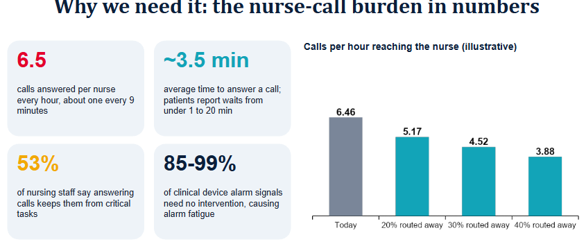
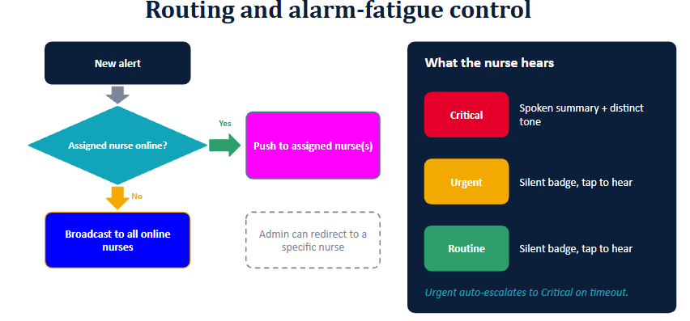
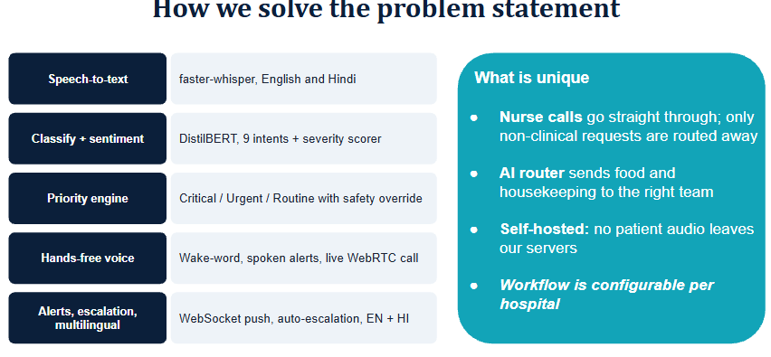
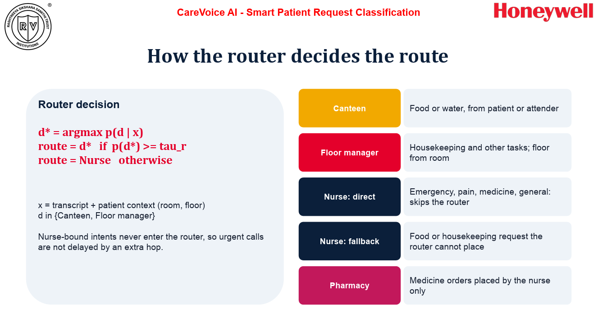
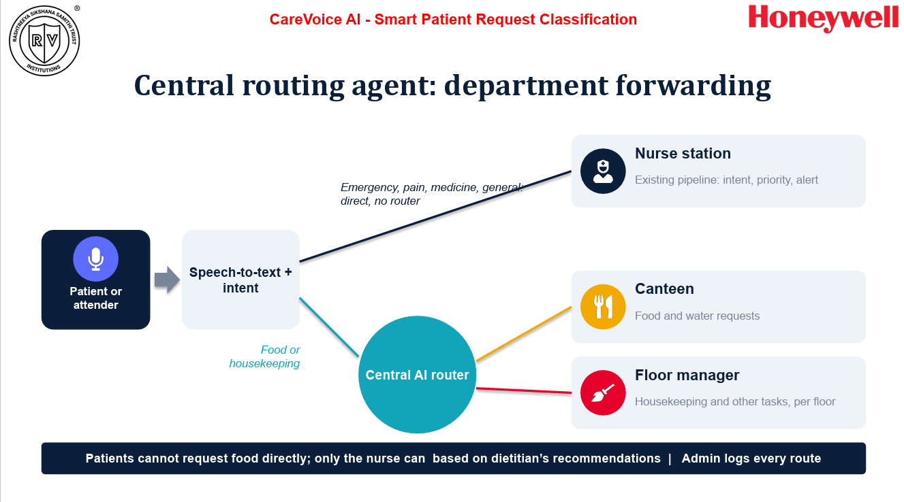
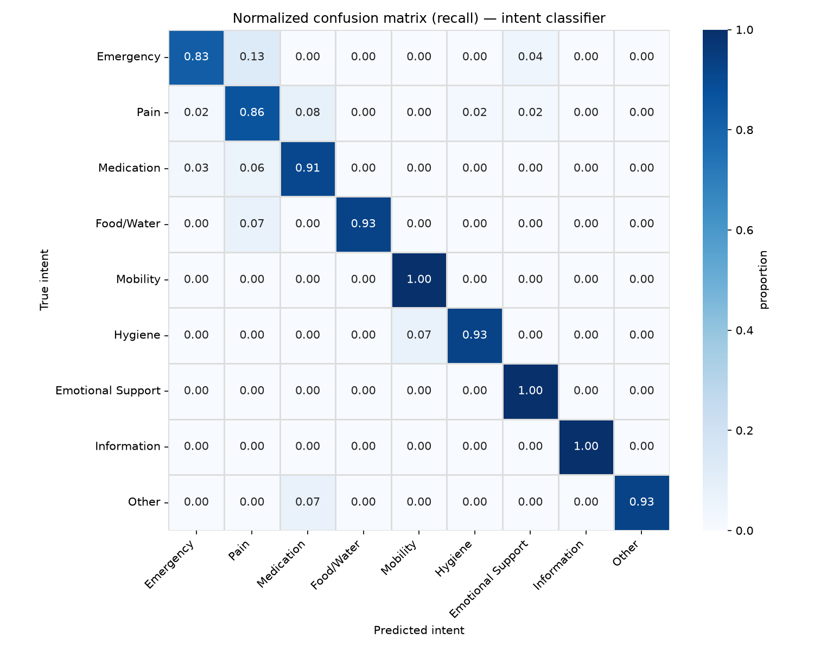
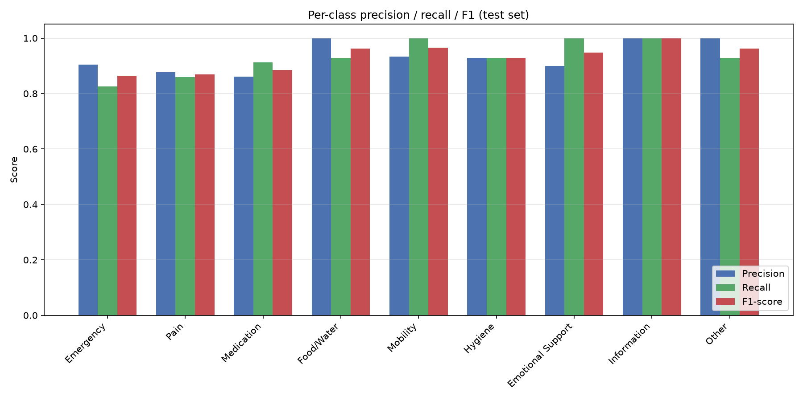
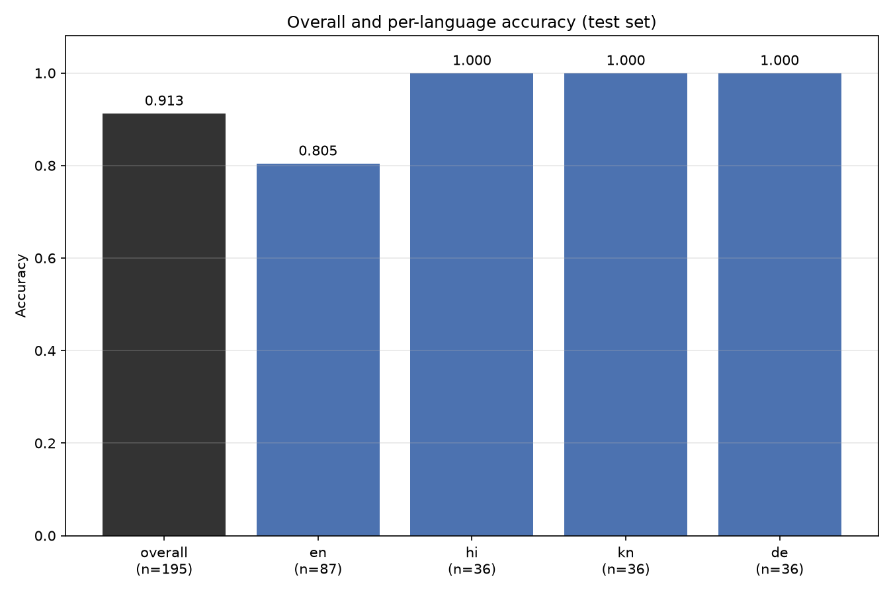
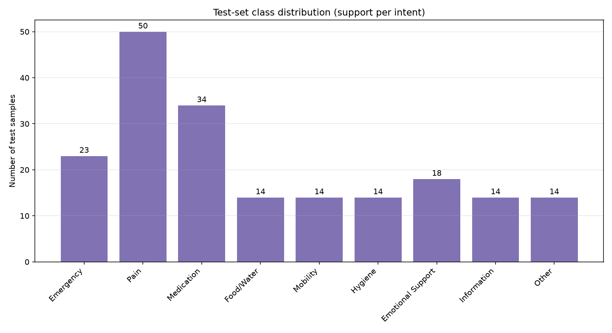

# CareVoice AI

**Voice-driven hospital nurse-call triage.** A patient speaks a request in **English or Hindi** — the system transcribes it, understands what they need, judges how urgent it is, and pushes a prioritized alert to the assigned nurse's dashboard in real time. When a conversation is needed, either side can start a peer-to-peer voice call.

The entire AI pipeline runs on infrastructure you control (a self-hosted server). No patient audio is sent to third-party AI APIs.

---

## Table of contents

- [What it does](#what-it-does)
- [Prototype overview and screenshots](#prototype-overview-and-screenshots)
- [Architecture](#architecture)
- [The AI pipeline](#the-ai-pipeline)
- [Tech stack](#tech-stack)
- [Repository layout](#repository-layout)
- [API reference](#api-reference)
- [Quick start (local)](#quick-start-local)
- [Building the Android app](#building-the-android-app)
- [Deploying the server (AWS EC2 + Caddy)](#deploying-the-server-aws-ec2--caddy)
- [Configuration](#configuration)
- [The intent model](#the-intent-model)
- [Security](#security)

---

## What it does

1. **Patient side (Android).** The app listens on-device for a wake word ("help", "nurse", "emergency"). On trigger it records the follow-up message, encodes it to WAV, and uploads it. There's also an instant **Call Nurse** button that raises a Critical alert with no audio.
2. **Server side.** The audio runs through a four-layer AI pipeline (speech-to-text → intent → NLP summary + emotion → priority), an alert is stored, and it is broadcast over a WebSocket to the nurse station.
3. **Nurse side (Android + web).** A live dashboard shows incoming alerts sorted by priority, filtered to the nurse's assigned rooms. Critical alerts are announced aloud via text-to-speech. Nurses acknowledge alerts and can place a voice call back to the patient.
4. **Real-time voice calls.** Patient and nurse can hold an audio call over **WebRTC** (peer-to-peer media; the server only relays signaling).
5. **Admin dashboard.** Hospital-wide monitoring — Overview, Dispatch, Alerts, Analytics, Approvals, Rooms, Patients, Nurses, and Server Logs. The same dashboard is served as a web page and embedded in the Android app (WebView), so both are always identical.

**Alert routing.** An incoming alert is delivered to the nurses **assigned to that patient's room**; if none are reachable it is broadcast to all nurses so a request is never dropped. From the admin **Dispatch** page an admin can reassign (redirect) any pending alert to a specific nurse, or mark a nurse occupied/free.

---

## Prototype overview and screenshots

CareVoice AI is a working prototype of a voice-driven hospital request system (Android app v2.9 plus a FastAPI server). The slides below summarize the problem, the routing design and the solution.

### Why it is needed



### How we solve it



### Routing and alarm-fatigue control

An alert goes to the assigned nurse if she is online, otherwise it is broadcast to all online nurses. An admin can redirect it to a specific nurse. Critical alerts are spoken with a distinct tone, Urgent and Routine show a silent badge, and Urgent auto-escalates to Critical on timeout.



### Central routing agent

Emergency, pain, medicine and general requests go straight to the nurse and skip the router. Only food and housekeeping requests reach the central router, which forwards them to the Canteen or the Floor manager. Patients cannot request food directly; the nurse orders it based on the dietician's recommendations. The admin logs every route.



### How the router decides

The router picks `d* = argmax p(d | x)` over {Canteen, Floor manager} and routes there if `p(d*) >= tau_r`. Otherwise the request falls back to the nurse. Nurse-bound intents never enter the router, so urgent calls are not delayed by an extra hop.



### Patient app features

- **Hands-free voice requests.** Speak a wake word ("help", "nurse", "madad") and the app records your message on-device, so a bedridden or low-mobility patient can call for help without touching the phone.
- **On-device speech detection.** Wake-word listening and energy-based voice-activity detection run entirely on the phone (no always-on streaming). A recording starts only when you actually speak.
- **Instant "Call Nurse" button.** One tap raises a Critical emergency alert with no recording needed. It carries full patient context (name and request summary) and is routed and broadcast to a nurse even if the assigned nurse is offline.
- **Two-way communication.** Real-time WebRTC voice calls with your nurse, plus voice notes you can record and receive, with on-device translation and spoken playback. The speak and listen language is chosen in Settings (English / Hindi / German).
- **Simple, configurable and multilingual.** Clear status feedback (listening / recording / sent), works in English, Hindi and German, and the server address is configurable in Settings for any hospital LAN or hosted deployment.
- **LLM-based medical query responses and emotional intelligence.** A Groq LLM replies to simple health-related queries. Responses are kept short and limited, with the emotional side of the conversation in mind.

### Nurse app features

- **Real-time alert feed.** Live incoming requests over WebSocket (with a 15 s HTTP poll fallback), sorted by priority with Critical / Urgent / Routine badges, patient name, request summary and emotion. Every request is read aloud (all categories, not just Critical) in the nurse's chosen language.
- **One-tap acknowledge, reliably.** Acknowledge any request instantly. The ACK handles races and already-acknowledged requests gracefully, so it never gets stuck and no logout/login workaround is needed.
- **Smart request dispatch.** Requests for the nurse's own patients go straight to Acknowledge. Requests reassigned or broadcast from other patients show an Accept/Decline offer. A nurse handling a reassigned request can call that patient and exchange voice notes until it is resolved.
- **Automatic status with manual override.** Status switches to Occupied while the nurse holds requests and back to Available once all are acknowledged, synced to the admin board. A manual Available/Occupied toggle is available when free.
- **Two-way patient communication.** WebRTC voice calls to the patient, plus voice notes with on-device translation and spoken playback (English / Hindi / German). A push notification arrives when a voice note comes in.
- **Instant call and manual alerts.** Manual "Call Nurse" emergencies show full patient context (name and summary, no blanks) and are routed and broadcast even when the primary nurse is offline, so nothing is missed.
- **Dedicated patient care.** Nurses can order medicines from the pharmacy and food from the canteen as prescribed by the dietician.

### Admin dashboard features

- **Live dispatch board.** Real-time nurse availability (Free / Occupied / Offline) and all pending requests, refreshing every 5 s. Nurse status is automatic: Occupied as soon as a request is held, Available again once all are acknowledged, on both the board and the nurse's phone.
- **Smart routing and reassignment.** Every request flows primary nurse, then broadcast to all free nurses, then admin escalation, for all request types including manual "Call Nurse" alerts. An admin can reassign any request to any online nurse in one tap. A reassigned nurse is temporarily mapped to that patient so she can call and exchange voice notes until it is resolved. Requests are never dropped: if the assigned nurse is offline or busy, the request is broadcast and surfaces as "Needs reassignment".
- **Full hospital management.** Approve or reject nurse registrations; manage rooms (status, ward, assignments); keep a patient registry with nurse assignment and discharge/re-admit; browse complete nurse and patient directories. All configurable to the hospital's requirements.
- **Alerts and analytics.** A searchable, paginated alert log (filter by room, priority, status) and analytics on alert trends by priority, intent, room and time of day, nurse workload and acknowledgment rate.
- **Reliability and operations.** One-click Reset Nurses to clear stuck states, live server-log monitoring and resilient acknowledgment handling. English / Hindi / German across voice requests, alerts and notifications.
- **Unified and on-premises.** The same light-themed dashboard runs in a browser and inside the app (WebView). Data stays on your own server.

### Roles

| Role | Interface | What they do |
|---|---|---|
| Patient | Android app | Wake word or **Call Nurse**, voice notes, WebRTC call, **My Health** assistant |
| Attender | Android app / web | Unlocks a menu with a room PIN and orders their own meal from the canteen |
| Nurse | Android app + web | Live prioritized alerts, ACK, spoken alerts, background notifications, patient care page |
| Admin | Web dashboard (also WebView in the app) | Dispatch, analytics, approvals, rooms, users, workflow settings, routing statistics |
| Doctor, Dietician, Floor manager, Canteen | Web dashboards | Case history and summaries, diet recommendations, ground-support and food requests |

### Intent model evaluation

Generated by `server/ml/plot_intent_ml.py`.

| Confusion matrix (normalized) | Per-class metrics |
|---|---|
|  |  |

| Accuracy per language | Class support |
|---|---|
|  |  |

### Known prototype limitations

- Seeded demo credentials exist and must be changed before any real use.
- Push notifications use a foreground service, not Firebase Cloud Messaging.
- The intent model (~516 MB) is not in the repository; use stub mode or train it (see [The intent model](#the-intent-model)).
- A single server process is assumed (in-memory timers and caches).
- The Groq LLM is a third-party API, so health-query text (not audio) leaves your server when it is enabled.

---
## Architecture

```
┌──────────────────┐                                  ┌──────────────────────┐
│  Android app     │                                  │  Nurse dashboard      │
│  (patient)       │                                  │  (Android + web)      │
│                  │   1. WAV upload (HTTPS POST)      │                       │
│  wake word +     │ ───────────────────────────────► │                       │
│  energy VAD      │        /audio/ingest              │                       │
└──────────────────┘                                  └──────────────────────┘
        │                          │                            ▲
        │                          ▼                            │
        │              ┌────────────────────────────┐          │ 2. live alert
        │              │  Caddy (HTTPS)              │          │    (WebSocket
        │              │     │  reverse proxy        │ ─────────┘    /ws/nurse)
        │              │     ▼                       │
        │              │  FastAPI server (uvicorn)   │
        │              │  Whisper → DistilBERT →     │
        │              │  NLP summary → priority     │
        │              └────────────────────────────┘
        │                          │
        │                          ├── SQLite   (alerts / transcripts)
        │                          └── Postgres (users / patients)
        │
        │   3. WebRTC voice call  (signaling relayed via /ws/signal;
        └──────────────────────────  Opus/SRTP media flows peer-to-peer)
```

**Why this shape**

- The server runs as a **single always-on process** (a systemd service behind Caddy) so the in-memory alert broadcaster and the SQLite alerts DB are shared by every connected patient and nurse. (Scaling out would require moving broadcasts to Redis pub/sub and alerts to Postgres.)
- **WebRTC media is peer-to-peer** — the backend never carries audio, only the setup handshake, keeping call latency low and server load flat.
- **Two databases by design:** transient, high-write alert data in SQLite; durable account/ward data in Postgres.

---

## The AI pipeline

Every uploaded utterance flows through four layers in `server/pipeline.py`, `nlp_summary.py`, and `priority_engine.py`:

### Layer 1 — Speech-to-text (Whisper)

- [`faster-whisper`](https://github.com/SYSTRAN/faster-whisper) running `medium` on GPU (`float16` on CUDA), falling back to `small` on CPU.
- **Robust multilingual handling.** Whisper misreads Hindi speech in known ways, so the transcriber corrects them — for example, Urdu-script output is re-transcribed as Hindi (Devanagari), and a language hint can force the intended language to avoid auto-detect ambiguity.

### Layer 2 — Intent classification (fine-tuned DistilBERT)

- A fine-tuned [`distilbert-base-multilingual-cased`](https://huggingface.co/distilbert/distilbert-base-multilingual-cased) classifies the transcript into one of **9 intents**: Emergency, Pain, Medication, Food/Water, Mobility, Hygiene, Emotional Support, Information, Other.
- The transformer produces contextual token embeddings; a classification head maps the pooled representation to the intent label — one forward pass, no external vector store.
- A **high-precision multilingual keyword override** runs alongside the model: when the transcript clearly contains an intent's keywords, that wins over the model prediction. This fixes model inconsistency on Whisper's Hindi spelling variants.
- If the model can't load, the pipeline degrades gracefully to a pure keyword matcher.

### Layer 3 — NLP summary + emotional intelligence

`nlp_summary.py` turns the transcript into a nurse-readable message deterministically (no cloud, no cold start):

- **Text normaliser** — collapses diacritic/spelling variation (साँस / सांस / सास → one form) so keyword matching is robust.
- **Severity scorer** — maps to an emotional state (`calm` / `anxious` / `distressed` / `panicked`) with a numeric magnitude.
- **Request summariser** — produces a short description ("wants water", "chest pain — possible cardiac emergency").
- **Auto-message generator** — assembles the standardized alert: *"Patient X in Room Y is calling — the patient sounds distressed — chest pain — possible cardiac emergency."*

### Layer 4 — Priority engine (with a safety override)

`priority_engine.py` maps intent → **Critical / Urgent / Routine**:

- Emergency → Critical; Pain, Medication → Urgent; everything else → Routine.
- **Safety net:** a curated list of life-threatening phrases ("can't breathe", "chest pain", …) across English and Hindi and multiple scripts forces **Critical** regardless of the model's guess. A "call the doctor" family of phrases forces at least **Urgent**.
- Unacknowledged **Urgent** alerts auto-escalate to **Critical** after a timeout so a forgotten request re-pages the nurse.

> The design principle throughout: **the model provides coverage, deterministic rules provide safety.** A misclassification should never silently downgrade a life-threatening request.

---

## Tech stack

| Layer | Technology |
|---|---|
| Android client | Kotlin, MVVM (ViewModel + LiveData), View Binding, Coroutines, OkHttp |
| Voice calls | WebRTC (`io.github.webrtc-sdk`), STUN/TURN, foreground service |
| On-device speech | Android `SpeechRecognizer` (wake word) + energy-based VAD |
| On-device translation | Google ML Kit (English ↔ Hindi voice-note transcripts) |
| Backend | FastAPI (async Python), Uvicorn, WebSockets |
| Speech-to-text | faster-whisper (CTranslate2) |
| Intent model | HuggingFace Transformers + PyTorch (fine-tuned DistilBERT) |
| Databases | SQLite (alerts) · PostgreSQL (users + patients) |
| Auth | JWT (python-jose), Argon2 password hashing (passlib) |
| Deployment | AWS EC2 (Amazon Linux) · systemd · Caddy (HTTPS reverse proxy) |

---

## Repository layout

```
.
├── app/                         # Android client (Kotlin)
│   ├── build.gradle
│   ├── proguard-rules.pro
│   └── src/main/
│       ├── AndroidManifest.xml
│       ├── kotlin/com/carevoice/app/
│       │   ├── LoginActivity / RegisterActivity      # auth screens
│       │   ├── MainActivity / MainViewModel          # patient home (wake word, upload)
│       │   ├── NurseActivity + AlertAdapter/Model    # nurse dashboard
│       │   ├── AdminActivity                         # admin console (WebView of /admin)
│       │   ├── WakeWordDetector / SileroVAD          # on-device speech triggers
│       │   ├── AudioRecorder / WavUtils / ServerUploader
│       │   ├── NurseTts / TtsManager                 # spoken alert announcements
│       │   ├── VoiceNote* / NoteTranslator           # voice notes + on-device translation
│       │   ├── CallActivity / IncomingCallActivity   # WebRTC call UI
│       │   ├── CallService / CallSession             # call lifecycle
│       │   ├── WebRtcCallManager / SignalingClient   # WebRTC + signaling
│       │   ├── AppUpdater                            # in-app auto-update (checks /app/version)
│       │   └── UserSession
│       └── res/                                      # layouts, drawables, values
├── server/                      # FastAPI backend
│   ├── main.py                  # app entry, lifespan, router wiring, auto-escalation
│   ├── config.py                # settings (env-overridable)
│   ├── models.py                # Pydantic schemas / API contract
│   ├── pipeline.py              # real ASR + intent pipeline
│   ├── pipeline_stub.py         # stub pipeline (no ML, local dev)
│   ├── nlp_summary.py           # summary + emotion (Layer 3)
│   ├── priority_engine.py       # intent → priority + safety markers (Layer 4)
│   ├── intent_keywords.py       # multilingual keyword override
│   ├── routing.py               # deliver alerts to assigned nurses / broadcast; redirect
│   ├── database.py / pg_database.py   # SQLite + Postgres access
│   ├── routers/                 # auth, audio, alerts, admin, ws, patient_ws, signal, voice_notes
│   ├── static/                  # web dashboards (login / nurse / admin) + app_version.json
│   ├── ml/                      # training + eval scripts, prepared datasets
│   └── storage/                 # runtime: models, wav_temp, sqlite db (gitignored)
├── deploy/                      # AWS EC2 provisioning (systemd unit, Caddy, DB setup scripts)
├── build.gradle                 # Android root build config
└── README.md
```

---

## API reference

Interactive docs are served at `/docs` (Swagger). Core endpoints:

**Auth** (`/auth`)
| Method | Path | Purpose |
|---|---|---|
| POST | `/auth/login` | Log in (nurse or patient), returns JWT |
| GET | `/auth/me` | Current user profile |
| POST | `/auth/register/patient` | Patient signup |
| POST | `/auth/register/nurse` | Nurse signup (requires `NURSE_ADMIN_KEY`) |
| GET | `/auth/patients` | Patients assigned to the calling nurse |

**Audio + alerts**
| Method | Path | Purpose |
|---|---|---|
| POST | `/audio/ingest` | Upload WAV → run pipeline → create alert |
| POST | `/alerts/manual` | Instant Critical alert (no audio) |
| GET | `/alerts/latest` | Recent alerts (optionally unacked only) |
| POST | `/alerts/{id}/ack` | Acknowledge an alert |
| POST | `/alerts/{id}/redirect` | Dispatcher: reassign an alert to a specific nurse |

**WebSockets**
| Path | Purpose |
|---|---|
| `/ws/nurse` | Real-time alert push to nurse clients |
| `/ws/patient` | Always-on patient audio streaming (server-side VAD) |
| `/ws/signal` | WebRTC call signaling relay |

**Admin** (`/admin/*`, admin role) — hospital stats, dispatch board, nurse/patient/room management, alert analytics, nurse approvals, patient assignment/discharge, server logs.

**App update** — `GET /app/version` returns the latest published Android build manifest (used by the in-app auto-updater). The APK is served from `/static/carevoice-latest.apk`.

**Health** — `GET /health` returns status, version, pipeline mode, and DB path.

---

## Quick start (local)

### Prerequisites
- Python 3.11
- PostgreSQL (local) for users + patients — or a managed Postgres connection string
- Android Studio / SDK for the client
- Optional: NVIDIA GPU + CUDA for fast Whisper inference

### Run the backend

```powershell
cd server
python -m venv .venv
.\.venv\Scripts\activate            # Windows
# source .venv/bin/activate         # Linux/macOS
pip install -r requirements.txt

Copy-Item .env.example .env          # then edit — set the secrets below
```

Set at minimum in `server/.env`:

```
SECRET_KEY=<python -c "import secrets; print(secrets.token_hex(32))">
NURSE_ADMIN_KEY=<a key nurses must supply to register>
PG_PASSWORD=<your local postgres password>          # or use DATABASE_URL_OVERRIDE
USE_STUB=true                                        # skip ML for quick UI testing
```

Run it:

```powershell
python -m uvicorn main:app --host 0.0.0.0 --port 8000
```

- Login / nurse dashboard: `http://localhost:8000/`
- Admin dashboard: `http://localhost:8000/admin`

Tables and sample accounts are seeded automatically on first startup.

---

## Building the Android app

Open the project root in Android Studio, or build from the command line:

```powershell
.\gradlew.bat :app:assembleDebug
adb install -r app/build/outputs/apk/debug/app-debug.apk
```

- The default server URL is set in `app/src/main/kotlin/com/carevoice/app/ServerUploader.kt` (`DEFAULT_SERVER_URL`) and is overridable in the app's Settings screen. Point it at `http://<your-machine-ip>:8000` for local testing, or at your deployed HTTPS URL.
- Builds are signed with the Android **debug keystore** (`~/.android/debug.keystore`); there is no release signing config. In-app auto-updates only install over an app signed with the **same key**, so keep building with the same machine's debug key (or add a release `signingConfig` and keep the keystore safe).
- **In-app auto-update:** on launch the app calls `GET /app/version`; if the manifest `versionCode` is higher than the installed build it offers to download and install `/static/carevoice-latest.apk`. To publish an update: bump `versionCode`/`versionName` in `app/build.gradle`, rebuild, copy the APK to `server/static/carevoice-latest.apk` on the server, and bump the matching fields in `server/static/app_version.json`.

---

## Deploying the server (AWS EC2 + Caddy)

The production server runs on an **Amazon Linux EC2 instance** as a systemd service behind **Caddy** (which terminates HTTPS automatically). The `deploy/` folder contains the units and provisioning scripts. A fresh setup, roughly:

1. **Launch an EC2 instance** (Amazon Linux 2023, user `ec2-user`). Open inbound **443** (HTTPS) and **22** (SSH) in the security group. Give it a public IP/DNS.

2. **Copy the server code** to `/home/ec2-user/carevoice-server` (e.g. `scp -r server/ ec2-user@<host>:~/carevoice-server`).

3. **Install Python deps** (CPU-only torch by default — see the script):
   ```bash
   bash deploy/install_deps.sh
   ```

4. **Set up PostgreSQL** on the box and write the `.env`:
   ```bash
   bash deploy/setup_db.sh        # creates the carevoice DB + role
   bash deploy/write_env.sh       # writes server/.env (SECRET_KEY, NURSE_ADMIN_KEY, PG creds)
   ```
   Make sure `server/.env` has `USE_STUB=false` and valid `SECRET_KEY` / `NURSE_ADMIN_KEY`.

5. **Provide the intent model** (optional; stub mode works without it). Copy a trained `intent_ml/` into `server/storage/models/intent_ml/` — see [The intent model](#the-intent-model).

6. **Install the systemd service** so the API runs on `127.0.0.1:8000` and restarts on boot/crash:
   ```bash
   sudo cp deploy/carevoice.service /etc/systemd/system/
   sudo systemctl daemon-reload
   sudo systemctl enable --now carevoice
   systemctl status carevoice
   ```

7. **Set up Caddy** as the HTTPS reverse proxy (auto-TLS). Edit `deploy/Caddyfile` to your hostname, then:
   ```bash
   bash deploy/setup_caddy.sh
   sudo cp deploy/Caddyfile /etc/caddy/Caddyfile
   sudo cp deploy/caddy.service /etc/systemd/system/   # if not using the distro's unit
   sudo systemctl restart caddy
   ```
   Caddy obtains a certificate and proxies `https://<your-host>` → `127.0.0.1:8000`.

8. **Point the clients** at the public HTTPS URL: set `ServerUploader.DEFAULT_SERVER_URL` in the Android app (or change it in Settings), and open `https://<your-host>/admin` for the web admin dashboard.

**Updating a running server:** copy the changed files into `/home/ec2-user/carevoice-server/`, then `sudo systemctl restart carevoice`. Static files under `server/static/` (dashboards, `app_version.json`, the APK) are served live and don't require a restart.

> A convenience hostname like `sslip.io` (which maps an IP into a hostname, e.g. `3-110-163-212.sslip.io`) lets Caddy issue a real certificate without owning a domain.

---

## Configuration

All settings live in `server/config.py`, overridable via environment variables or `server/.env`.

| Variable | Purpose | Default |
|---|---|---|
| `USE_STUB` | Use the stub pipeline (no ML) | `false` |
| `WHISPER_MODEL` | Whisper size (`small` / `medium` / …) | `medium` |
| `WHISPER_DEVICE` | `cuda` or `cpu` | `cuda` |
| `DATABASE_URL_OVERRIDE` | Full Postgres URL — wins over `PG_*` | — |
| `PG_PASSWORD` | Postgres password (local dev) | — (must set) |
| `SECRET_KEY` | JWT signing key | — (**must set**; auth fails if empty) |
| `NURSE_ADMIN_KEY` | Key required to register a nurse | — (**must set**; registration disabled if empty) |
| `CORS_ORIGINS` | Allowed origins | empty → all (with warning) |
| `ESCALATE_URGENT_AFTER_SECONDS` | Urgent→Critical auto-escalation delay | `90` |

The server logs a security warning on startup if `SECRET_KEY` or `NURSE_ADMIN_KEY` is unset.

---

## The intent model

The trained classifier (`intent_ml`, ~516 MB) is **not committed to git** (exceeds GitHub file-size limits). Two ways to run:

### Option A — Stub mode (no model, fastest)
Set `USE_STUB=true`. Login, dashboards, alerts, WebSocket, and calls all work; only intent classification is simplified. No GPU or download needed.

### Option B — Train the real model (reproducible)
The prepared splits are committed under `server/ml/data/prepared_ml/`. Fine-tune `distilbert-base-multilingual-cased` on the bilingual (English + Hindi) 9-intent dataset:

```powershell
cd server/ml
python train_intent_ml.py           # writes to server/storage/models/intent_ml/
python evaluate_intent_ml.py         # optional: per-language accuracy
```

Training uses **weighted cross-entropy** (weights inversely proportional to class frequency) to handle class imbalance, tracks **macro-F1**, 8 epochs, LR 3e-5, max sequence length 64. A GPU trains it in a few minutes; CPU works but is slower.

The server loads from exactly `server/storage/models/intent_ml/` (`model.safetensors`, `config.json`, `tokenizer.json`, `vocab.txt`, …). If you obtain the folder another way, drop it there and set `USE_STUB=false`.

Whisper weights download automatically on first run via `faster-whisper` — nothing to do manually.

---

## Security

- **Secrets are never committed.** `server/.env` is gitignored; `SECRET_KEY`, `NURSE_ADMIN_KEY`, and the database URL are provided via env vars or `.env`. `config.py` ships with **empty** defaults and warns loudly at startup if they're missing.
- **Auth:** JWT bearer tokens (8-hour expiry, one shift); passwords hashed with Argon2. Nurse registration is gated by `NURSE_ADMIN_KEY`.
- **Media privacy:** patient audio is processed transiently in `storage/wav_temp/` and is not retained long-term; WebRTC call audio flows peer-to-peer and never touches the server.
- **Transport:** Caddy terminates HTTPS/TLS in front of the API; the app's WebView admin bridge only hands the session token to pages on the configured server origin.
- **CORS** should be restricted to your dashboard origins in production (`CORS_ORIGINS`).
